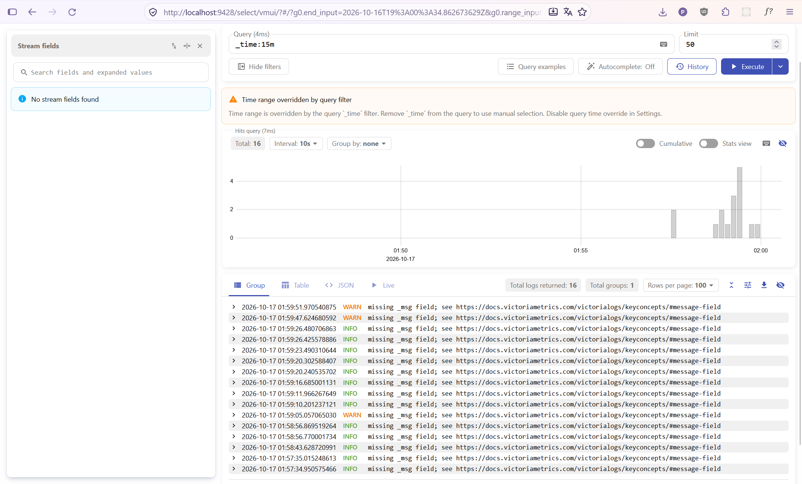
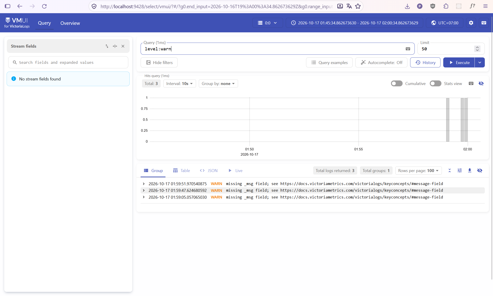
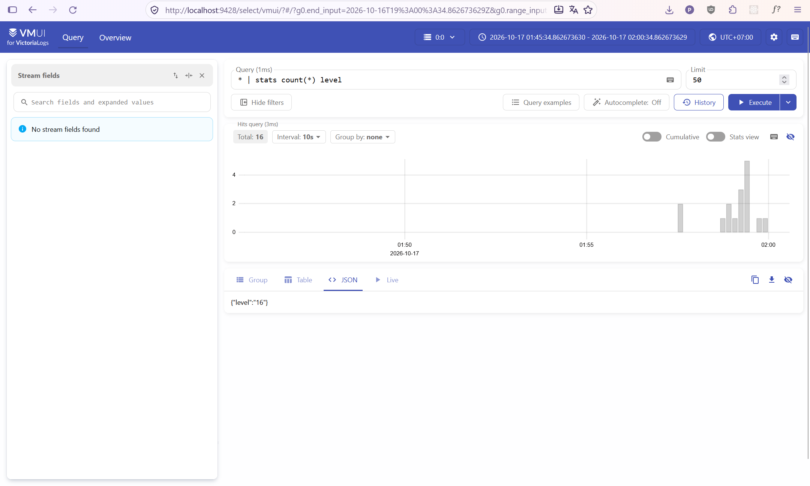

# Домашнее задание №3. Логирование

## Способ доставки логов

Для доставки логов был выбран прямой HTTP-пуш логов в формате JSON из кода бэкенда напрямую в эндпоинт Victoria Logs (`/insert/jsonline`). В локальной среде разработки Minikube на Windows (поверх Docker Desktop) сборщики логов уровня ноды (такие как Fluent Bit) принудительно оборачивают вывод контейнеров в служебные текстовые префиксы среды оркестрации. Прямая отправка логов по HTTP позволяет избежать искажения структуры данных, гарантирует нативный парсинг JSON-полей базой данных Victoria Logs и исключает необходимость разворачивать ресурсоемкие DaemonSet-агенты.

## LogsQL-запросы:

### А) Сырые записи за последние 15 минут

`_time:15m`: база данных вернула поток из 16 сырых логов, зафиксированных за последние 15 минут.

### Б) Фильтр по конкретному полю

`level:warn`: фильтрация потока логов по точному совпадению пользовательского поля `level`. Запрос вывел 3 лога событий предупреждения.

### В) Stats-запрос с группировкой

`* | stats count(*) level`: аналитический запрос группировки. Функция `stats count(*)` производит суммарный подсчет всех зарегистрированных событий по группам поля `level`.

### Г) Агрегирующий запрос

`* | stats count_uniq(context)`: статистический запрос, вычисляющий количество уникальных функциональных модулей бэкенда, которые отправляли логи за все время работы. Результат вывел 6 уникальных контекстов.

